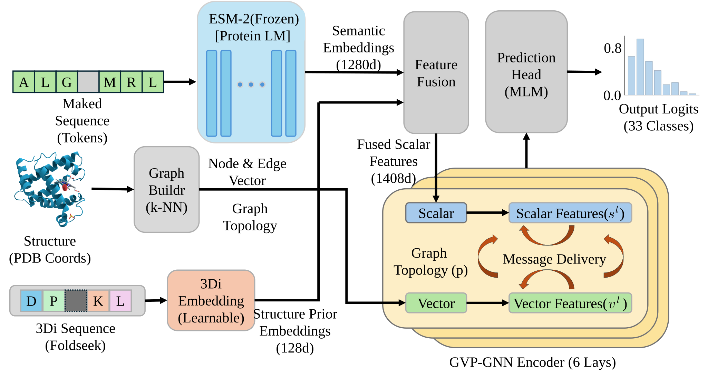

# Struct-MIF

**Structure-aware Masked Inverse Folding: Integrating Evolutionary Semantics and Structural Priors for Zero-Shot Mutation Effect Prediction**

Official codebase for *Struct-MIF*, which combines a frozen protein language model, a discrete structural alphabet, and an equivariant geometric encoder for zero-shot mutation effect prediction using wild-type structures alone.

---

## Overview

Struct-MIF is a three-stream architecture that fuses complementary sources of protein information:

| Stream | Encoder | Role |
| --- | --- | --- |
| Semantic | Frozen ESM-2 (650M) | Long-range evolutionary context |
| Prior | Foldseek 3Di embedding | Discrete local backbone conformation |
| Geometric | 6-layer GVP-GNN | Continuous SE(3)-equivariant geometry |

The three streams are concatenated into a 1408-dimensional scalar input and refined by SE(3)-equivariant message passing. Mutations are scored with the masked log-likelihood ratio (LLR), requiring only the wild-type structure and no mutant structure modelling.

Training uses masked language modelling on a non-redundant subset of CATH v4.3.0 (30,948 domains, 40% sequence identity cutoff, maximum length 1024 residues) for 150 epochs. Only the non-ESM parameters are trainable (~9.0M), so the full pipeline fits on a single consumer GPU.



---

## Results

### Benchmarks

| Benchmark | Content |
| --- | --- |
| ProteinGym v1.0 | 217 substitution assays (activity, binding, expression, organismal fitness, stability) |
| ΔTm | 66 assays / 2,520 variants, curated from ProThermDB |
| ΔΔG | 36 assays / 829 variants, curated from DDMut |

The ΔTm and ΔΔG splits follow the ProtSSN study (Tan et al., *eLife* 2025), from which the baseline values below are likewise adopted. All models are scored with Spearman's rank correlation.

### Thermodynamic stability

| Model | Version | ΔTm | ΔΔG |
| --- | --- | ---: | ---: |
| ESM2 | t12 | 0.214 | 0.216 |
| | t30 | 0.288 | 0.317 |
| | t33 | 0.330 | 0.392 |
| | t36 | 0.327 | 0.351 |
| | t48 | 0.311 | 0.252 |
| CARP | – | 0.288 | 0.333 |
| ProtTrans | bert | 0.268 | 0.313 |
| | bert_bfd | 0.217 | 0.293 |
| | t5_xl_uniref50 | 0.310 | 0.365 |
| | t5_xl_bfd | 0.239 | 0.334 |
| ESM-IF1 | – | 0.395 | 0.409 |
| MIF-ST | – | 0.400 | 0.406 |
| SaProt | masked | 0.382 | – |
| | unmasked | 0.376 | 0.359 |
| ProtSSN | k20_h512 | 0.419 | 0.442 |
| | Ensemble | 0.425 | 0.440 |
| **Struct-MIF** | – | **0.455** | **0.492** |

Struct-MIF improves over the strongest single-model baseline (ProtSSN k20_h512) by 8.6% on ΔTm and 11.3% on ΔΔG, and over the ProtSSN ensemble by 7.1% and 11.8%.

### Pre-training cost

| Model | ProteinGym | Pre-training data | Hardware | Time | GPU-days |
| --- | ---: | --- | --- | --- | ---: |
| S3F | 0.483 | CATH (+surface) | 4×A100 | – | – |
| **Struct-MIF** | **0.481** | **CATH (30,948)** | **1×RTX 4090** | **~12 h** | **~0.5** |
| ProSST (K=512) | 0.481 | UniRef50 + AF2 | 8×A800 | ~30 d | ~240 |
| ProSST (K=128) | 0.477 | UniRef50 + AF2 | 8×A800 | ~30 d | ~240 |
| S2F | 0.468 | CATH | 4×A100 | – | – |
| SaProt (650M) | 0.464 | AF2-UniRef50 | 8×GPU | – | – |

Hardware configurations are taken from each model's official repository. Dashes indicate values not reported in the released materials. Because these figures derive from codebases built for different corpora, length limits, and objectives, they indicate the resource tier required rather than a controlled efficiency benchmark.

### Clinical variants

On ClinVar pathogenic/benign annotations for PTEN, TP53, and MSH2, Struct-MIF reaches AUC-ROC of 1.00, 1.00, and 0.83. AUC reflects ranking discrimination and is not directly comparable to the accuracy metrics reported for functional assays.


---

## Installation

Conda is recommended:

```bash
conda env create -f environment.yaml
conda activate struct_mif
```

Preprocessing additionally requires the **Foldseek** binary. Place it at `data/bin/foldseek` or ensure `foldseek` is on your `PATH`.

### Hardware

- **Inference** — ≥8 GB VRAM is sufficient (e.g. RTX 3060/4060)
- **Pre-training** — ≥24 GB VRAM recommended (RTX 3090/4090, A5000, A100); 64 GB system RAM or more avoids I/O bottlenecks with multi-worker loading

Reference configuration: Intel i9-14900K, 1× RTX 4090 (24 GB), 128 GB RAM.

### Pre-training hyperparameters

| Parameter | Value |
| --- | --- |
| Batch size | 16 |
| Gradient accumulation steps | 2 |
| Learning rate | 1e-4 |
| Epochs | 150 |
| Optimizer | AdamW |
| Dataloader workers | 8 |

---

## Quickstart

### 1. Data preprocessing

Extract 3D backbone coordinates and Foldseek 3Di tokens from PDB files and build k-NN graphs:

```bash
PYTHONPATH=. nohup python scripts/1_preprocess_graphs.py \
    --input_dir /path/to/your/pdb_files \
    --output_dir data/processed_graphs \
    --foldseek_bin ./data/bin/foldseek \
    --k_neighbors 30 \
    --num_workers 16 \
    > preprocess_run.log 2>&1 &
```

> Set `--input_dir` to the directory holding your CATH domains or any other PDB collection.

### 2. Pre-training

```bash
PYTHONPATH=. nohup python scripts/2_pretrain.py \
    --train_path ./data/processed_graphs \
    --esm_model_path ./pretrained_models/esm2_t33_650M_UR50D \
    --output_dir experiments/struct_mif \
    --epochs 150 \
    --gvp_layers 6 \
    --hidden_dim 128 \
    --top_k 30 \
    --gnn_type gvp \
    --batch_size 16 \
    --accum_steps 2 \
    --lr 1e-4 \
    --num_workers 8 \
    > experiments/struct_mif/train.log 2>&1 &
```

Additional flags: `--ablation {none,no_3di}` disables the 3Di stream, `--gnn_type {gvp,egnn,gcn,gat}` swaps the geometric encoder, `--resume <path>` continues from a checkpoint.

### 3. Zero-shot evaluation

**Thermodynamic stability (ΔTm / ΔΔG):**

```bash
PYTHONPATH=. python scripts/4_benchmark_dtm.py \
    --dtm_root data/DDG/DATASET \
    --checkpoint experiments/struct_mif/checkpoint_epoch_150.pt \
    --esm_model ./pretrained_models/esm2_t33_650M_UR50D \
    --foldseek_bin ./data/bin/foldseek \
    --gvp_layers 6 \
    --hidden_dim 128 \
    --top_k 30 \
    --gnn_type gvp \
    --output_csv experiments/struct_mif/ddg_results.csv
```

**ProteinGym:**

```bash
PYTHONPATH=. python scripts/5_benchmark_proteingym.py \
    --json_file protssn_experiment_plan.json \
    --checkpoint experiments/struct_mif/checkpoint_epoch_150.pt \
    --esm_model ./pretrained_models/esm2_t33_650M_UR50D \
    --foldseek_bin ./data/bin/foldseek \
    --gvp_layers 6 \
    --hidden_dim 128 \
    --top_k 30 \
    --gnn_type gvp \
    --output_csv experiments/struct_mif/proteingym_results.csv
```

### 4. Utilities

| Script | Purpose |
| --- | --- |
| `scripts/3_zero_shot_score.py` | Score an arbitrary variant list for a single PDB |
| `scripts/6_all_dtm.py` | Sweep all saved checkpoints over the stability benchmarks |
| `scripts/7_all_gym.py` | Sweep all saved checkpoints over ProteinGym |
| `scripts/8_visualize_latent.py` | Project learned representations for inspection |
| `scripts/check_model_integrity.py` | Verify architecture, tensor alignment, and gradients |
| `scripts/check_data_leakage.py` | Homology scan between pre-training and benchmark sets |

---

## Data availability

- **ProteinGym v1.0** — <https://proteingym.org>
- **ΔTm / ΔΔG splits** — released with [ProtSSN](https://github.com/ai4protein/ProtSSN)
- **CATH v4.3.0** — <https://www.cathdb.info>
- **ProteinGym structures** — AlphaFold2-predicted models from the ProteinGym release

---

## Pre-trained Weights

We provide the pre-trained weights for the main Struct-MIF model, as well as the variant models used in our ablation studies. 

You can download all the model checkpoints from one drive and place them in the `./experiments/` directory.

### 1. Main Model

This is the primary full-parameter model with the complete multi-modal architecture used for the main results in the paper.

| Model                 | Description                            |                        Download Link                         |
| :-------------------- | :------------------------------------- | :----------------------------------------------------------: |
| **Struct-MIF (Full)** | The complete multi-modal architecture. | [checkpoint_best_model.pt](https://onedrive.live.com/?listurl=%2Fpersonal%2Fe768fe104e832a19%2FDocuments&viewid=c6b72bfb%2D4712%2D405c%2Da589%2D25468a113b15&id=%2Fpersonal%2Fe768fe104e832a19%2FDocuments%2FA%20Student%2F%E5%BC%A0%E9%94%A6%2F%E5%B7%A5%E4%BD%9C%E4%B8%80%2FStruct%2DMIF%2Fexperiments%2Fbest%5Fmodel%2Fcheckpoint%5Fthe%5Fbest%5Fmodel%2Ept&parent=%2Fpersonal%2Fe768fe104e832a19%2FDocuments%2FA%20Student%2F%E5%BC%A0%E9%94%A6%2F%E5%B7%A5%E4%BD%9C%E4%B8%80%2FStruct%2DMIF%2Fexperiments%2Fbest%5Fmodel) |

### 2. Ablation Study Models

To facilitate reproducibility of our ablation experiments, we also provide the weights for the model variants.

| Model Variant                  | Download Link                                                |
| :----------------------------- | :----------------------------------------------------------- |
| **Struct-MIF (w/o 3DI)**       | [best_checkpoint.pt](https://1drv.ms/u/c/E768FE104E832A19/ARowaWjayNhEiLyxwY6ZW4o?e=lGkaHv) |
| **Struct-MIF (GCN)**           | [best_checkpoint.pt](https://1drv.ms/u/c/E768FE104E832A19/AXHfsYOdhW9Di77MIGZmAJc?e=di5niG) |
| **Struct-MIF (GAT)**           | [best_checkpoint.pt](https://1drv.ms/u/c/E768FE104E832A19/ATIAF5ftdTBPg2NtbPzcRvY?e=eoczHy) |
| **Struct-MIF (EGNN)**          | [best_checkpoint.pt](https://1drv.ms/u/c/E768FE104E832A19/AfnSbWeD2ppEmXPO5bLGuy4?e=aVpTtt) |
| **Struct-MIF (GVP layers=12)** | [best_checkpoint.pt](https://1drv.ms/u/c/E768FE104E832A19/AUmzotE2eU1Ol1Cv862c8eg?e=Sdme3q) |
| **Struct-MIF (GVP layers=18)** | [best_checkpoint.pt](https://1drv.ms/u/c/E768FE104E832A19/AXBlR8slGmpJg7X9okzXdRk?e=tW8gbB) |
| **Struct-MIF (h=256)**         | [best_checkpoint.pt](https://1drv.ms/u/c/E768FE104E832A19/AdfFDQdHO6NBn7eUM_jgN5A?e=aqTYL8) |
| **Struct-MIF (h=512)**         | [best_checkpoint.pt](https://1drv.ms/u/c/E768FE104E832A19/ARNu7-WSGyRIhX5Ln_g9TBk?e=mO4fU4) |
| **Struct-MIF (h=768)**         | [best_checkpoint.pt](https://1drv.ms/u/c/E768FE104E832A19/AaRcnmKNhTxGhkKM2ZDH4vE?e=l8QFCp) |
| **Struct-MIF (k=10)**          | [best_checkpoint.pt](https://1drv.ms/u/c/E768FE104E832A19/AX5Y65BiKSJOmzUjglUnWF0?e=aWRBzg) |
| **Struct-MIF (k=20)**          | [best_checkpoint.pt](https://1drv.ms/u/c/E768FE104E832A19/ARJyo6MnPmFNhB3l58LT-nY?e=GxFQSU) |

> **Note:** If you are only interested in running the standard inference or evaluating on the ProteinGym benchmark, downloading the **Main Model** is sufficient.

---

## Project structure

```
Struct-MIF/
├── configs/                     # YAML configs (base, training, inference)
├── data/                        # Raw PDBs, processed graphs, benchmarks
├── experiments/                 # Checkpoints and training logs
├── figures/                     # Figures from the paper
├── scripts/                     # Entry-point scripts (see table above)
├── src/
│   ├── common/                  # Alphabets, Foldseek utilities, PDB parser
│   ├── data/                    # Dataset, collator, graph builder
│   ├── modeling/                # ESM wrapper, fusion, GVP encoder, GNN adapters
│   ├── loss.py                  # Masked MLM loss
│   └── scoring.py               # Masked LLR scoring
├── environment.yaml
└── protssn_experiment_plan.json # ProteinGym assay configuration
```

---

## Reproducibility notes

- **Masking** — ratio 0.15 follows standard BERT/ESM practice: 80% of selected positions receive `<mask>`, 10% are replaced with a random amino acid, 10% are left unchanged.
- **Frozen encoder** — ESM-2 is kept in eval mode and excluded from the optimizer throughout training.
- **Tensor alignment** — ESM-2 appends `<cls>` and `<eos>`, so its output has length L+2 while the k-NN graph has L nodes; the semantic tensor is truncated to L during fusion.
- **3Di extraction** — tokens are produced by `foldseek structureto3didescriptor`; the one-letter alphabet (`dpvliakegshtrfywmcnq`) maps to a 21-entry embedding table with index 0 reserved for padding.
- **Graph construction** — directed k-NN edges over Cα coordinates (k = 30, self-loops removed).

## Acknowledgements

This code builds on [ESM](https://github.com/facebookresearch/esm), [GVP](https://github.com/drorlab/gvp-pytorch), and [Foldseek](https://github.com/steineggerlab/foldseek). We thank the authors for releasing their code.

## Citation

```bibtex
@article{wang2026structmif,
  title   = {Struct-MIF: Integrating Evolutionary Semantics and
             Structural Priors for Zero-Shot Mutation Effect Prediction},
  author  = {Wang, Dong and Zhang, Jin and Lu, Bin and Liu, Qiaoming and Luo, Ximei},
  journal = {Frontiers of Computer Science},
  year    = {2026}
}
```
